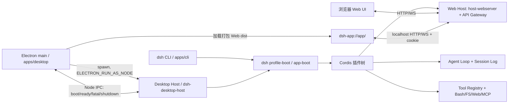

# DeepSeek Harness 实现原理与架构分析

> 分析基准：`deepseek-ai/deepseek-harness` tag `dsh-v0.2.1-rc.2`（commit `687f282e`）。
> 结论先行：DSH 是一个 **Cordis 全插件式 agent harness**；Web、桌面、CLI、SDK、ACP 都是同一套插件树的不同 profile。桌面端不是独立实现，而是 Electron 壳 + 私有的 Desktop Host + 同一套 Web 应用。

## 1. 进程与启动拓扑



- CLI 入口：`apps/cli` → `packages/boot/dsh` 的 `lib/bin.js`；`dsh web`、`dsh --profile headless ...` 等命令只是选择不同 profile。
- Electron 入口：`apps/desktop/src/main.ts`。它先创建窗口并加载打包后的 `dsh-app://app/`，再由 `dsh-desktop-host` 以 Electron Node 模式启动同一个 Web 应用；Host 就绪后通过 Node IPC 把启动注入信息交给页面。
- 因此桌面与 Web 共用插件、会话、工具、模型适配器和前端，仅“载体”不同。

## 2. Cordis：一切皆插件

- `vendor/cordis` 提供 Context、服务、类型化事件、effect 和 Loader。
- 插件向 `ctx` 注册服务（如 `ctx.sessions`、`ctx.tools`、`ctx.llm`、`ctx.shell`、`ctx.sandbox`）；注册返回 disposer，卸载即回滚，没有需要打补丁的“特权内核”。
- 事件是扩展点：session 事件写日志并可重放；agent 事件描述运行中的 Agent；capability 事件（`fs/*`、`tools/*`、`telemetry/*`）用于在能力接缝上挂策略或适配器。
- 一个能力（capability seam）通常由 Service Definition、Provider、Consumer 三角色组成；例如 `dsh-sandbox`（定义）→ `dsh-sandbox-local`（提供者）→ `dsh-bash-sandbox`（消费者）。

## 3. Profile / Bundle / Patch：启动树如何装配

- **Profile**：`$DSH_HOME/profiles/<name>/` 下的 `package.json` + `cordis.patch.yml`。`package.json` 的 `dsh.profile.bundles` 是有序 bundle 列表；`cordis.patch.yml` 是用户覆盖层。
- **Bundle**：以 npm 包形式分发的一组 Cordis 配置行与代码；在自己的 `package.json` 中用 `dsh.bundle` 指向 patch 文件。
- **装配顺序**（后面的层覆盖前面的同 id 行）：
  1. `dsh.profile.bundles` 中每个 bundle 的 patch；
  2. profile 自己的 `cordis.patch.yml`；
  3. `$DSH_HOME/cordis.patch.yml`；
  4. 命令行 `--patch` overlay。
- 关键 bundle：`@deepseek-ai/dsh-base`（模型、会话、工具、沙箱、持久化、凭据等共享底座）；`dsh-web-app`（浏览器应用与 Host 传输）；`dsh-headless`（一次性任务）；`dsh-sdk-app` / `dsh-sdk-minimal`（JSON-RPC SDK）；`dsh-acp-app`（ACP stdio）。
- 可复现检查：`dsh --profile web --dump-config` 打印组合后的树；`--dump-config-schema` 打印插件配置的 JSON Schema。

## 4. 一次 Turn 的数据流

`docs/architecture.md` 给出的主链路：

```text
turn/start
  claim next-step input + queued message
  assemble system prompt sections + tool schemas
  agent/pre-step
  step/start
  agent/request -> prepareCall
  append user/message; log request/header
  stream -> llm/stream -> agent/assistant-stream chunk*
  assistant/message | assistant/attempt
  tool/call* -> tools/pre-execute -> tools/execute -> tools/post-execute -> tool/result*
  step/end
  (tools owe another request | next-step input) -> next step
turn/end
```

- `packages/core/session` 维护 append-only 的 `SessionEvent` 日志；任何模型可见输入都必须可从日志重建（model-visible ⟺ logged）。
- `packages/core/agent-loop` 是默认 Agent 驱动器；`packages/core/tools` 是带作用域和守卫的工具注册表；`packages/llm/llm` 定义流式消息与适配器接缝。
- 持久化：`dsh-session-persistence-jsonl` 写会话；`dsh-session-query-sqlite` 提供检索；`dsh-session-projection` 做列表/统计投影。
- 上下文管理：`packages/compaction/*` 提供基础压缩、图片卸载、工具结果裁剪。
- 工具族：fs、bash、pwsh（Windows）、web、MCP、jobs、subagent、goal、schedule、skill、workflow、PTC 等；每个工具都有 Host 侧呈现与 Web 侧卡片。

## 5. Web 与 Desktop 的分层

- **Web Host**：`dsh-web-app` 挂载 `dsh-host-webserver`、`dsh-client-connection`、API gateway、各客户端插件。浏览器通过 `/api` 和 WebSocket 访问 Host；Host 绑定 `127.0.0.1`，支持 loopback/监听地址/trustedHosts 校验。
- **Desktop**：`apps/desktop` 只负责窗口、菜单、托盘、更新、协议、目录选择等壳能力；真正的 Host 是 `apps/desktop-host`（发布包名 `@deepseek-ai/dsh-desktop-host`）。Electron 用 `ELECTRON_RUN_AS_NODE=1` 启动 Host，Host 调用共享 profile runner，加载 `desktop` profile（`dsh-web-app` + base + 桌面专属行）。
- **打包布局**：
  - `resources/runtime/primary-runtime/dependencies/{node,pnpm,python}`：独立解释器与 Python wheels；
  - `resources/runtime/cli/bin/dsh`：复用 Electron Node 的 CLI 启动器；
  - `app.asar/dsh/node_modules`：桌面生产依赖树（含 dsh 包与第三方依赖）；
  - `resources/runtime/versions.json` 与 `dsh/desktop-runtime.json`：版本与文件清单。
- **启动顺序**：`prepare:runtime`（下载 Electron/Node/Python/pnpm，生成运行时）→ `prepare:packages`（打包第一方 tarball 闭包）→ `prepare:dsh`（生产 pnpm install + 清单/校验）→ electron-builder 组装 → 运行时 smoke。

## 6. 平台适配点（Linux 视角）

| 关注点 | Windows / macOS 现状 | Linux 现状与处理 |
|---|---|---|
| Shell 工具 | pwsh / bash 按平台启用 | base patch 已按 `process.platform` 启用 bash、禁用 pwsh |
| 沙箱 | Windows ACL / macOS Seatbelt | `dsh-sandbox-local` 支持 bwrap → Landlock，按可用性 fail-closed |
| Office | 原生 libreoffice-kit | `selectOfficeEngine` 自动回退 `libreoffice-kit-wasm` |
| 主运行时 | Node/Python/pnpm 由 lock 固定 | `scripts/primary-runtime/lock.json` **已包含 linux-x64/arm64** |
| 桌面发布 | mac/win target、签名、更新 feed | `package-target.ts` / build paths / env 校验只列 mac/win；electron-builder 仅有一个最小 `linux: { target: ['AppImage'] }` |
| 更新 | electron-updater + feed | 无 Linux 发布链；v1 关闭更新入口 |
| 账户 | `desktop-mac` / `desktop-win` 平台头 | 保持 `desktopPlatform: null`（Web 身份）；API Key 可用 |
| 图标/托盘 | Windows tray.ico、macOS icns | Linux 用 PNG 应用图标，无托盘 |

**结论**：不需要重写 harness；Linux 适配的本质是补齐 Desktop 发布链（target、环境校验、Electron/CLI 路径、AppImage/deb 配置）并对 Linux 壳行为做最小裁剪。

## 7. 关键源码索引

| 目标 | 位置 |
|---|---|
| 架构总览 | `docs/architecture.md`、`docs/cordis-primer.md` |
| 装配与 bundle | `packages/boot/app-boot/`、`packages/bundle/*/cordis.patch.yml` |
| Agent / Session | `packages/core/agent-loop/`、`packages/core/session/`、`packages/core/tools/` |
| Web Host | `packages/bundle/web-app/`、`packages/host/webserver/`、`packages/client/connection/` |
| Desktop 壳 | `apps/desktop/src/main.ts`、`apps/desktop/README.zh.md` |
| Desktop Host | `apps/desktop-host/`（`@deepseek-ai/dsh-desktop-host`） |
| 打包 | `apps/desktop/scripts/{package-target,prepare-runtime,prepare-dsh,electron-builder-config}.mjs`、`apps/desktop/packaging/README.zh.md` |
| 运行时锁 | `scripts/primary-runtime/lock.json`、`scripts/primary-runtime/prepare.ts` |
| Linux 缺口 | `apps/desktop/scripts/desktop-build-paths.mjs`、`desktop-package-environment.mjs`、`package-target.ts` |

## 8. 可复现观察命令

```sh
# 查看实际组合后的插件树
dsh --profile web --dump-config

# 查看配置 JSON Schema
dsh --profile web --dump-config-schema

# 查看 Desktop 包内运行时布局（安装后）
find "$RESOURCES/runtime" -maxdepth 3 -type f | sort | head
find "$RESOURCES/app.asar/dsh" -maxdepth 2 -type f | sort | head

# 查看 Linux 是否识别为 bash + sandbox
dsh --profile web --dump-config | grep -E 'tool-bash|tool-pwsh|sandbox|bash-sandbox'
```

## 9. 本次 Linux 适配的代码边界

- 目标解析：`desktop-build-paths.mjs`、`package-target.ts`。
- 环境/工具链：`desktop-package-environment.mjs`、`desktop-toolchain-preflight.ts`。
- Electron/CLI 载荷：`prepare-runtime.ts`、`prepare-cli.ts`、`prepare-dsh.ts`、`apps/desktop/cli/dsh`。
- 打包：`electron-builder-config.mjs`（AppImage + deb、图标、desktop entry、policy/update 分支）。
- 壳行为：`apps/desktop/src/main.ts`（Linux 关闭自动更新入口）。
- 验证：`smoke-packaged-runtime.ts`、`apps/desktop/linux/*`。

更细的构建与限制见 `docs/linux/BUILD.zh.md` 与 `docs/linux/LIMITATIONS.zh.md`。